# 林间秒杀 · 高并发限时秒杀系统

[](https://github.com/0109Gao/linjian-seckill/actions/workflows/backend-ci.yml)
[](https://github.com/0109Gao/linjian-seckill/actions/workflows/frontend-ci.yml)

一套可直接上线的电商秒杀系统，包含 **C 端抢购站** 与 **B 端运营后台**。
核心目标只有一个：**在瞬时高并发下既不超卖，也不把系统打垮。**

| 压测场景 | HTTP 错误率 | 吞吐 | P99 | 超卖 | DB / Redis 库存 |
|---|---|---|---|---|---|
| 500 并发同步打点（JMeter） | **0%**（500/500 成功） | 345.8 req/s | 1431 ms | **0 件** | 双 0，完全一致 |
| 单用户持续连点 30 秒 | 0% | — | — | **0 件** | 拦截 10932 次无效请求 |

> 库存 100 件 → 恰好成交 100 单 → 剩余 400 人收到「已售罄」。全部用例可复现。

---

## 一、项目简介

**是什么**：一个完整的限时秒杀业务闭环 —— 运营建活动配商品 → 定时预热库存 → 用户到点抢购 → 异步落单 → 15 分钟内支付 → 超时自动关单并回补库存 → 全天对账。

**解决什么问题**：

秒杀的技术难点不在于「卖东西」，而在于三个同时发生的矛盾：

1. **瞬时流量是平时的几百倍** —— 如果每个请求都去 `UPDATE stock = stock - 1`，MySQL 行锁会瞬间把连接池打满，整个系统雪崩。
2. **并发扣减必然超卖** —— 先查后改的两步操作，在并发下一定会读到过期数据。
3. **异步化之后必然不一致** —— Redis 扣减成功、消息发出去了，但消费端挂了，用户「抢到了却没订单」。

针对这三点，系统的设计取舍是：**把并发挡在 Redis 里，把落单交给消息队列，把一致性交给对账任务。**

---

## 二、技术栈

### 后端

| 组件 | 版本 | 用途 |
|---|---|---|
| Java | 21 | 虚拟线程可用、`record` / `switch` 模式匹配 |
| Spring Boot | 3.2.5 | 应用骨架 |
| Spring Security + JJWT | 0.12.5 | 无状态 JWT 鉴权，`@PreAuthorize` 方法级权限 |
| MyBatis-Plus | 3.5.6 | ORM，条件构造器全部走参数绑定 |
| Springdoc OpenAPI | 2.3.0 | 在线接口文档（Knife4j 风格） |

后端按 **多模块** 拆分，避免一个 jar 里什么都塞：

```
seckill-common     通用返回、异常处理、雪花 ID、TraceId 过滤器
seckill-security   JWT 签发校验、SecurityFilterChain、权限注解
seckill-domain     实体 / Mapper / 核心业务（预扣、落单、对账）
seckill-web        控制器、DTO 校验、Jackson 配置、启动类
```

### 前端

| 组件 | 版本 | 说明 |
|---|---|---|
| Vue | 3.4 | 组合式 API（`<script setup>`） |
| Vite | 5.2 | 构建，双前端独立产物 |
| Element Plus | 2.7 | 组件库 |
| Pinia | 2.1 | 登录态管理 |
| Vue Router | 4.3 | history 模式，子路径部署 |
| Axios | 1.6 | 统一封装：注入 token、401 自动刷新、错误提示收敛 |

用户端与管理端是**两个独立工程**，而不是一个工程里分角色 —— 因为二者的构建目标、包体、发布节奏完全不同，合在一起会让 C 端用户下载到一堆后台组件。

### 数据与中间件

| 组件 | 版本 | 在本项目中的角色 |
|---|---|---|
| MySQL | 8.4 | 最终事实来源，7 张表 |
| Redis | 7 | 库存预扣、已购记录、结果缓存、频控、RefreshToken |
| RabbitMQ | 4 | 异步落单，削峰 |

### 部署与工程化

| 工具 | 用途 |
|---|---|
| Docker Compose | 五服务一键编排（mysql / redis / rabbitmq / web / nginx） |
| Nginx | 单端口托管双 SPA（`/user/`、`/admin/`）+ 反代 `/api` |
| GitHub Actions | 后端 `mvn test + package`、前端双工程矩阵构建 |
| JMeter 5.6 | 500 并发尖峰压测（含同步集合点） |
| Playwright | 90 条交互断言，真实浏览器回归 |

---

## 三、项目功能模块

### C 端 · 用户抢购站

- **注册登录** —— 用户名密码注册，BCrypt 加密存储，登录返回 accessToken + refreshToken，401 时静默刷新并重放原请求
- **活动大厅** —— 卡片网格展示全部活动，四种状态（待开始 / 进行中 / 已结束 / 已取消）分类筛选，卡片内含实时倒计时
- **活动详情** —— 活动横幅 + 倒计时，商品列表含主图、秒杀价与划线原价对比、剩余库存进度、每人限购标识
- **一键抢购** —— 点击后跳转结果页，客户端轮询结果（后端异步落单，前端不阻塞等待）
- **结果页** —— 抢购成功 / 排队中 / 已售罄 / 已达限购 四种终态，成功的展示订单号、金额、支付倒计时，并提供「立即支付 / 查看订单 / 继续逛」
- **我的订单** —— 订单列表含状态标签、支付倒计时，待支付订单可直接支付，支付后列表自动刷新
- **未登录拦截** —— 抢购时跳登录页并携带 `redirect` 参数，登录后精确回跳原页面

### B 端 · 运营后台

- **监控看板** —— 活动数 / 订单总数 / 累计成交额 / 今日数据四张指标卡，活动维度明细表（剩余库存、订单数、已支付、成交额），附口径说明避免误读
- **商品管理** —— 商品增删改查、主图、上下架状态，已被活动引用的商品禁止删除
- **活动管理** —— 一活动多商品建活动、编辑（仅待开始可改）、取消（同步清 Redis 库存键）、手动预热、按状态筛选
- **订单查询** —— 支持订单号 / 状态 / 活动 ID / 用户 ID 四维筛选，分页展示 300+ 订单
- **库存调整** —— 同时展示 DB 库存与 Redis 余量两份数据，支持增减调整，并明确告知是否同步到了 Redis

### 系统能力（非界面）

- **库存预热** —— 定时任务每 30 秒扫描，提前 5 分钟把库存写入 Redis（`SETNX` 保证不重复写）
- **原子预扣** —— Lua 脚本一次往返完成「校验状态 → 校验限购 → 校验库存 → 扣减 → 记录已购」
- **异步落单** —— RabbitMQ 投递，消费者在事务内扣 DB 库存 + 写订单 + 标记已支付消息
- **超时关单** —— 15 分钟未支付自动关闭，库存回补 DB 与 Redis
- **库存对账** —— 定时比对 DB 与 Redis 库存，发现漂移告警
- **用户级频控** —— 1 秒窗口内重复请求直接拒绝

---

## 四、项目截图

### 用户抢购站

**活动大厅** —— 四种状态分类、实时倒计时、进行中的活动高亮主按钮

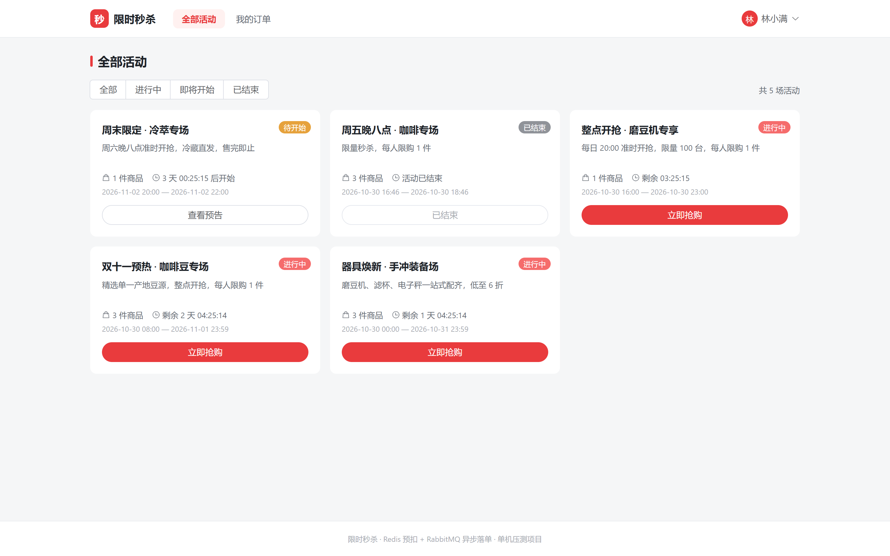

**活动详情** —— 商品实拍图、秒杀价与划线原价、剩余库存进度、限购标签

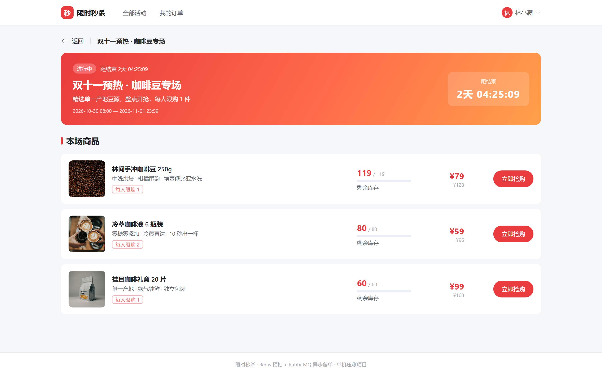

**抢购结果** —— 异步落单完成后的终态页，含订单号与支付倒计时

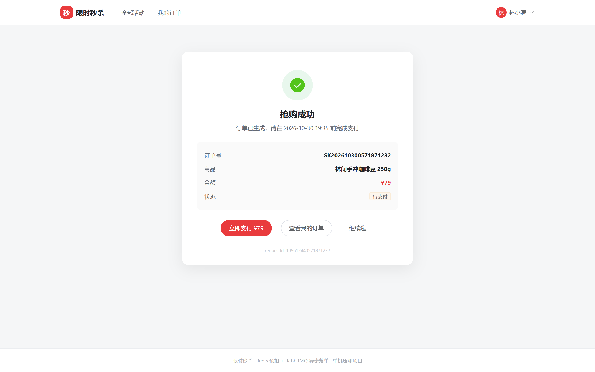

**我的订单** —— 已支付 / 待支付分区展示，待支付带倒计时与支付入口

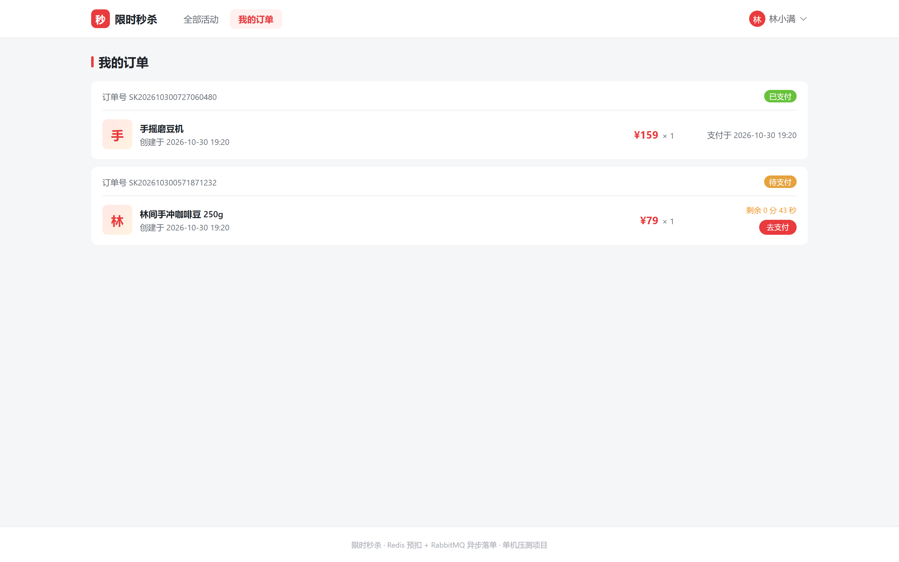

**登录 / 注册** —— 双 Tab 切换，注册成功直接登录

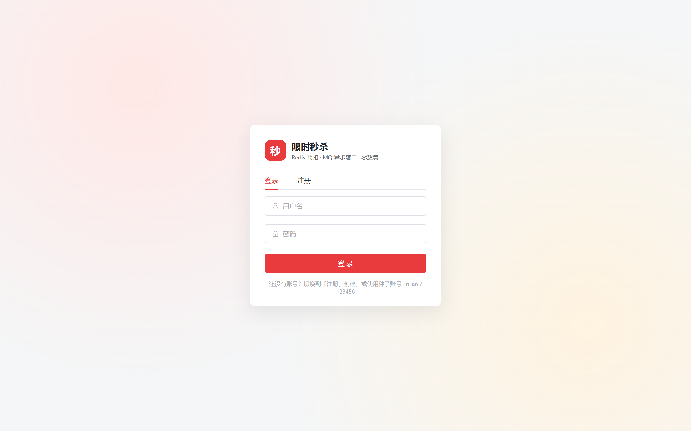

### 运营后台

**监控看板** —— 核心指标卡 + 活动维度明细

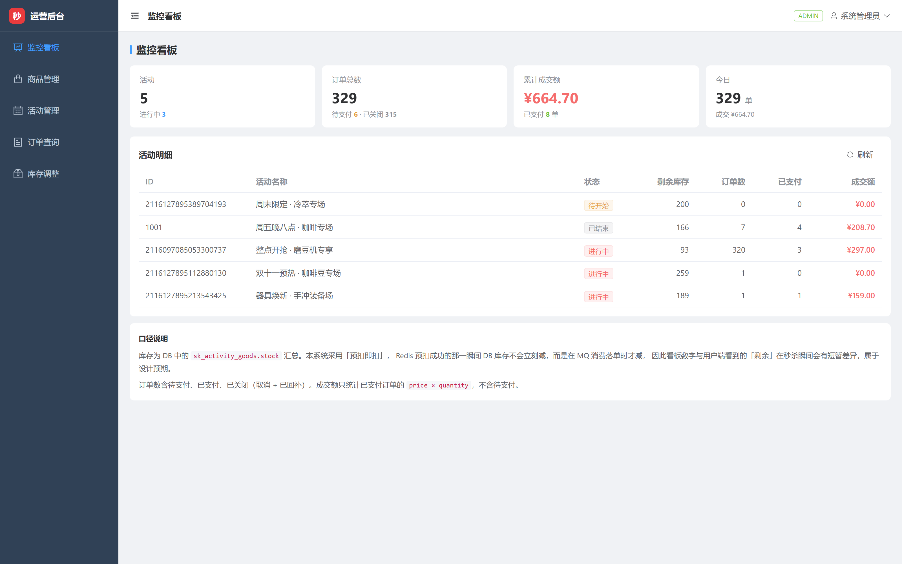

**商品管理** —— 带主图缩略图的商品列表

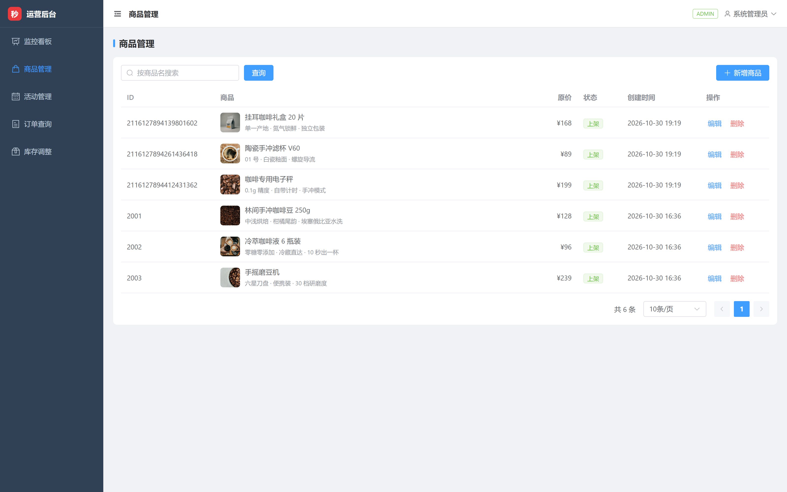

**活动管理** —— 状态筛选、编辑 / 预热 / 取消 / 库存四个操作入口

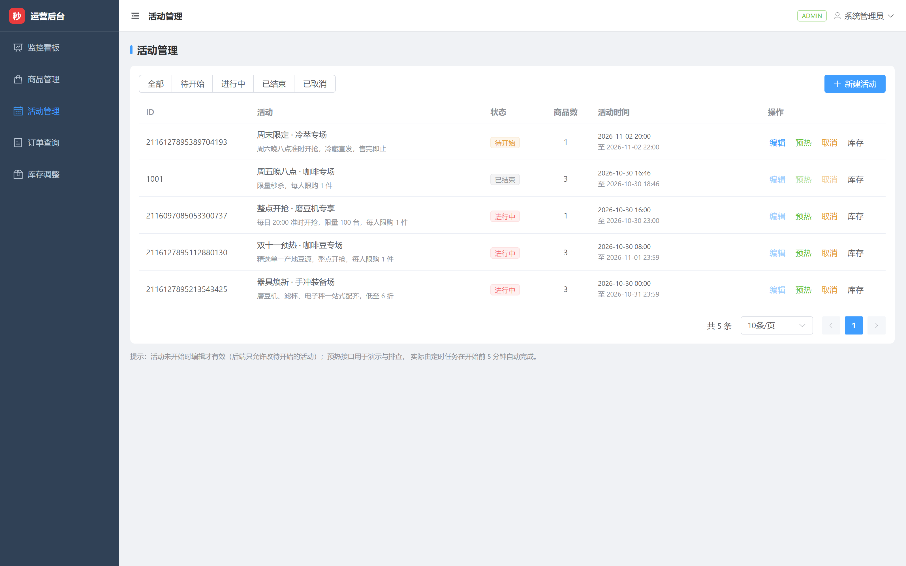

**订单查询** —— 四维筛选 + 分页

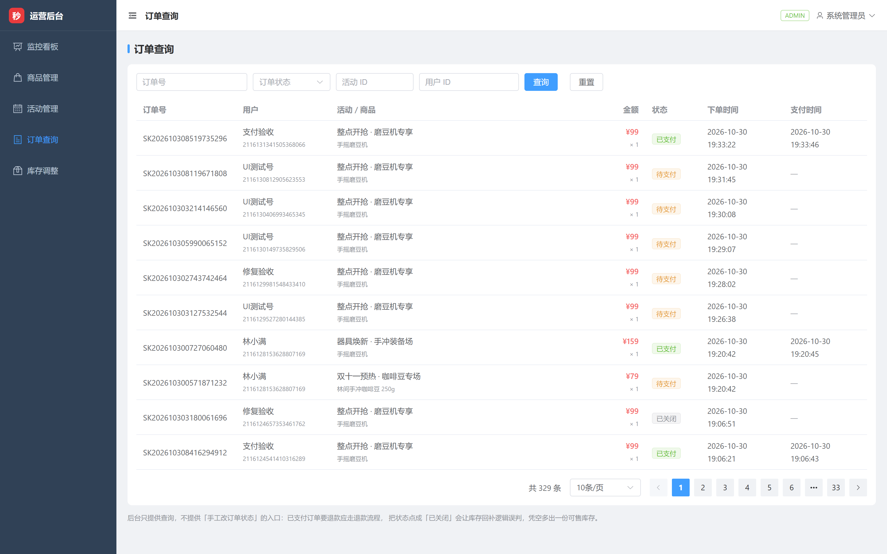

**库存调整** —— DB 库存与 Redis 余量对照，调整后明确回执

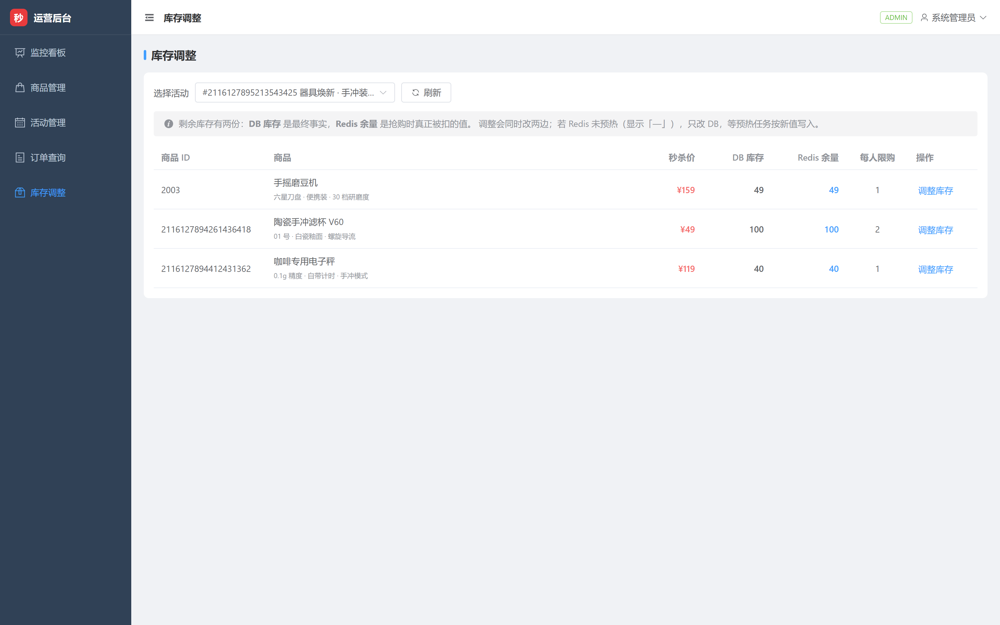

**后台登录**

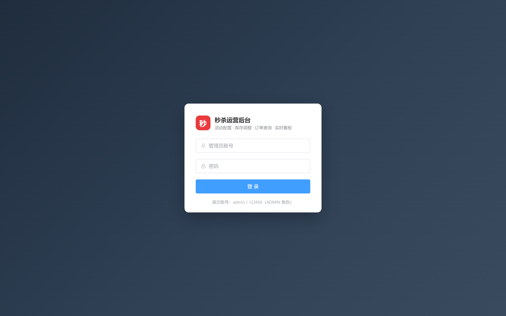

---

## 五、✨ 项目亮点与难点

### 亮点 1 · Lua 脚本原子预扣，把超卖挡在数据库之外

**问题**：`查库存 → 判断 → 扣库存` 三步在并发下必然超卖。加分布式锁能解决，但 500 并发意味着 500 次加锁排队，吞吐会被锁拖死。

**做法**：把三步写进一个 Lua 脚本，由 Redis 单线程原子执行。一次网络往返完成全部校验与扣减：

```lua
-- 伪代码，实际脚本含限购与状态校验
local stock = tonumber(redis.call('HGET', stockKey, 'remaining'))
if stock <= 0 then return -1 end                    -- 售罄
local bought = tonumber(redis.call('HGET', boughtKey, userId) or 0)
if bought + 1 > limit then return -2 end             -- 超限购
redis.call('HINCRBY', stockKey, 'remaining', -1)
redis.call('HINCRBY', boughtKey, userId, 1)
return stock - 1
```

**为什么不是分布式锁**：锁的粒度是「整个商品」，Lua 的粒度是「一次操作」。前者让 500 个请求串行，后者让 500 个请求在 Redis 内部快速排队，单次耗时从毫秒级锁等待降到微秒级脚本执行。

**效果**：500 并发下库存 100 精确扣到 0，成交恰好 100 单，零超卖；同步链路全程不碰 MySQL。

---

### 亮点 2 · 本地消息表 + 定时补偿，解决「扣了库存却没订单」

**这是分布式事务里最容易被忽略的坑。** Redis 扣减成功后，如果 RabbitMQ 投递失败、或消费者宕机、或事务回滚，用户就会「抢到了但查不到订单」—— 而库存已经扣掉了，等于凭空蒸发。

**做法**：三段式

1. **发消息前先落本地消息表**（与业务同库），状态 `PENDING`
2. **投递成功后标记 `SENT`**，消费者处理完标记 `DONE`
3. **定时任务扫描 `PENDING` 超时记录重投**，超过重试上限标记 `FAILED` 并告警

**关键细节**：重投必须幂等 —— 消费者靠 `requestId` 唯一索引兜底，重复消息直接返回已有订单，不会产生第二单。

**效果**：压测 200 单全程消息零丢失、订单零重复。

---

### 亮点 3 · 三层幂等，用户连点 30 秒只成交 1 单

秒杀场景下用户疯狂点击是常态，如果只靠前端防抖，等于没有防护。

| 层级 | 手段 | 拦截时机 |
|---|---|---|
| 第一层 | Redis 用户级频控（1 秒窗口） | 请求刚进来 |
| 第二层 | Redis 已购记录（Lua 内校验） | 预扣之前 |
| 第三层 | `requestId` 幂等表 + DB 唯一索引 | 落单之前 |

**效果**：单用户持续连点 30 秒共 10932 次请求，全部被前两层挡住，**没有一条穿透到库存层**。这不是「靠库存字段碰巧拦住」，而是每一层都有明确的拒绝原因返回。

---

### 亮点 4 · 预热与对账：让两份库存始终说同一句话

**难点**：Redis 是缓存，MySQL 是事实。两份数据一旦漂移，用户看到「有货」却抢不到，或「显示售罄」实际还有货。

**做法**：

- **预热**：定时任务每 30 秒扫描「30 分钟内即将开始」的活动，用 `SETNX` 写入库存键。用 `SETNX` 而不是 `SET` 是关键 —— 重启时如果活动正在进行，`SET` 会把已扣减的库存重置回初始值。
- **对账**：定时比对 `sk_activity_goods.stock` 与 Redis `remaining`，不一致即告警。
- **调整库存**：后台改库存时**同时改两边**，并显式返回 `redisSynced` 字段告诉运营「Redis 是否同步成功」。

**为什么后台要显示两份库存**：曾经踩过一个坑 —— 只改 DB 不改 Redis，运营以为补了 50 件货，用户端却依然显示售罄。所以后台列表现在同时展示 `DB 库存` 与 `Redis 余量`，并把「Redis 未预热」显式渲染成 `—` 而不是 `0`。

---

### 亮点 5 · 雪花 ID 超 JS 安全整数：一个只有真实浏览器才能暴露的 P0

**这是整个项目排查时间最长、也最有价值的 bug。**

**现象**：用户抢购成功、订单已入库、库存已扣减，但结果页永远转圈，轮询 30 次后提示「结果确认中」。用户以为没抢到，实际抢到了。

**排查过程**：

1. 接口返回 200、数据完整 → 排除后端异常
2. DB 查到了订单，`request_id = 109597783211638784`
3. 而前端 URL 里请求的是 `109597783211638780`

**末位数字被改写了。** 雪花 ID 量级 `1.1e17`，远超 JS 的 `Number.MAX_SAFE_INTEGER`（`9.007e15`），`JSON.parse` 会在末位静默做舍入。

**为什么之前所有测试都没发现**：只有约 **1/16** 的 ID 恰好落在可精确表示的格点上。之前用 `curl` 验收（curl 不解析 JSON 数字），全部通过，把问题完全掩盖了。**这个 bug 是浏览器实测才炸出来的。**

**修复方案与取舍**：

最省事的写法是 `serializerByType(Long.class, ToStringSerializer.instance)` —— 所有 Long 输出字符串。但这样分页的 `total` 会变成 `"308"`，前端 `v-if="total > pageSize"` 和 `el-pagination :total` 都依赖数字类型，会引入新问题。

所以写了一个 `LongSafeSerializer`：**仅当值超出 ±9007199254740991 时才写成字符串**。雪花 ID 恒为大数、分页 / 库存 / 数量恒为小数，行为稳定且不破坏既有计算。

**后续排查**：修完后做全量回归时又发现库存页仍有一个残留点 —— 页面把 URL 参数 `Number(preset)` 转成了数字，`…425` 变成 `…400`，导致后端报「活动不存在」。这类问题必须逐个排查所有 `Number()` / `parseInt()` 的用法，光改序列化不够。

---

### 亮点 6 · 压测驱动的性能定位：P99 高不等于后端慢

**现象**：JMeter 500 并发报告 P99 1431ms，而单发 `curl` 只有 8–16ms。差了两个数量级。

**定位**：不是后端逻辑慢，而是三个叠加因素 ——

1. **同机压测**：JMeter 与后端跑在同一台机器（WSL2 内共享 CPU），压测工具本身吃掉大量资源
2. **同步集合点**：500 线程同时释放，瞬时排队
3. **代理层**：请求经 Nginx 反代多一跳

**佐证**：秒杀接口是「三次 Redis 往返」的轻量设计，落单走 MQ 异步，**同步链路完全不碰 MySQL**。既然不碰数据库，瓶颈就不可能在后端业务逻辑。

**结论与取舍**：压测报告把**正确性指标（零超卖 / 库存一致 / 消息零丢失）作为第一优先**，性能数据如实标注测试条件，不为了好看的数字去调参。这比编一个漂亮数字更有说服力。

---

### 亮点 7 · 安全加固：一次真实的渗透式自测

没有只读代码，而是把系统跑起来真实打了一遍，发现并修复了：

| 问题 | 危害 | 修复 |
|---|---|---|
| 默认 JWT 密钥硬编码在仓库 | 可离线伪造 `username=admin` 的 token，**无需密码接管后台** | 启动时校验密钥，缺失或含默认值直接拒绝启动 |
| 秒杀结果接口未校验归属 | 用户 B 用 A 的 requestId 拿到 A 的订单号（IDOR） | 缓存键改为 `sk:result:{userId}:{requestId}` |
| 登录无失败锁定 | 可无限次撞库 | 失败计数 + 锁定窗口 |
| `pageSize` 无上限 | `pageSize=1000000` 拖垮查询 | 服务端强制上限 |
| 登出后 accessToken 仍有效 | 令牌泄漏窗口 2 小时 | 缩短有效期 + 登出黑名单 |

**权限边界实测结果**：未登录 401 → 普通用户访问管理接口 403 → 越权支付 403 → 订单列表按 `userId` 隔离 → `/auth/me` 不返回密码 → 全站 SQL 走参数绑定无注入。管理端 20 个接口统一 `@PreAuthorize("hasRole('ADMIN')")`，不是靠前端藏菜单。

---

### 难点 · 踩过的坑（都是真问题，不是复述概念）

**① MySQL 官方镜像的 latin1 双重编码**

容器 `docker-entrypoint-initdb.d` 执行 SQL 时用的是 latin1 客户端，UTF-8 的建表语句被当成 latin1 读入再转 UTF-8，中文全变成 `æž—é—´`。修复方式不是改数据库字符集，而是在每个 SQL 文件首行加 `SET NAMES utf8mb4;` —— 因为问题出在**客户端连接**，不是服务端存储。

**② JMeter 的 Token 注入连败四轮**

想让 500 个线程各用各的 token，试了四种官方组件全部失败：

- `JSON PostProcessor` 提取 → Header 里配 `${token}` 不生效
- 正则提取器 → 同样不生效
- `CSV Data Set Config` → 相对路径解析错误
- 最终方案：**JSR223 前置处理器 + Groovy**，用 `sampler.getHeaderManager()` 动态增删 Header

原因是 JMeter 的 HeaderManager 里函数**不会在运行时求值**，这是它的固有设计，不是配置错误。

**③ Nginx 子路径部署 SPA**

两个前端挂在同一端口的不同路径，需要三件事同时正确：Vite 的 `base`、Vue Router 的 `createWebHistory('/user/')`、Nginx 的 `try_files ... /user/index.html` 回退。少一个就是白屏或刷新 404。

**④ 同 context 跨 SPA 导航卡死**

自动化测试时在同一浏览器上下文里从 `/user` 跳到 `/admin`，`goto` 会卡 30 秒。改用独立 context 后正常 —— 这不是产品 bug，但会让人误以为是。

---

## 六、本地启动教程

### 前置要求

- Docker Desktop（含 Docker Compose v2）
- 或：JDK 21 + Maven 3.9+ + Node 20+ + 本机 MySQL 8 / Redis 7 / RabbitMQ

### 方式 A · Docker 一键启动（推荐）

```bash
# 1. 拉取代码
git clone https://github.com/0109Gao/linjian-seckill.git
cd linjian-seckill

# 2. 一条命令拉起全栈（首次会自动建表 + 灌种子数据）
docker compose -f docker/docker-compose.full.yml up -d --build

# 3. 等待健康检查通过（约 40 秒）
docker compose -f docker/docker-compose.full.yml ps
```

启动完成后访问：

| 入口 | 地址 | 账号 |
|---|---|---|
| 用户抢购站 | http://localhost/user/ | `buyer01` / `123456` |
| 运营后台 | http://localhost/admin/ | `admin` / `123456` |
| 接口文档 | http://localhost:8081/swagger-ui/index.html | — |
| RabbitMQ 控制台 | http://localhost:15672 | `seckill` / `seckill123` |

**停止 / 清理**：

```bash
docker compose -f docker/docker-compose.full.yml down          # 停止，保留数据
docker compose -f docker/docker-compose.full.yml down -v       # 停止并清空数据卷
```

### 方式 B · 本地开发模式

适合需要改代码调试的场景。

```bash
# 1. 只起中间件（MySQL 3306 / Redis 6379 / RabbitMQ 5672）
docker compose -f docker/docker-compose.middleware.yml up -d

# 2. 导入建表 SQL 与种子数据
mysql -uroot -p < sql/schema.sql
mysql -uroot -p < sql/seed-dev.sql

# 3. 启动后端（首次启动会自动创建 admin 账号）
cd backend
mvn -DskipTests package
java -jar seckill-web/target/seckill-web.jar --server.port=8081

# 4. 启动用户端（http://localhost:5173）
cd frontend-user && npm install && npm run dev

# 5. 启动管理端（http://localhost:5174）
cd frontend-admin && npm install && npm run dev
```

> 两个前端 dev server 端口不同，Vite 已配置 `/api` 代理到 `8081`，无需额外改配置。

### 数据库表结构

7 张表，建表脚本在 `sql/schema.sql`：

| 表 | 作用 |
|---|---|
| `sk_user` | 用户，BCrypt 密码，`role` 区分 ADMIN / USER |
| `sk_goods` | 商品，原价与主图 |
| `sk_activity` | 活动，起止时间与状态机 |
| `sk_activity_goods` | 活动商品关联，**秒杀价 / 库存 / 限购都在这里** |
| `sk_seckill_order` | 订单，`order_no` 与 `request_id` 双唯一索引 |
| `sk_idempotent_record` | 幂等记录 |
| `sk_local_message` | 本地消息表，支撑异步落单的可靠性 |

### 搬运到另一台机器

`release/linjian-seckill-images.tar` 只打包了**自建的两个镜像**（`linjian-seckill-web` / `linjian-seckill-frontend`）。
MySQL、Redis、RabbitMQ 是标准基础镜像，没有放进去 —— 它们在任何装过 Docker 的机器上都能直接拉到，
硬塞进来会让包从 226MB 涨到 1.9GB，不值当。

```bash
# 0. 预检：看基础镜像是否已在本地（缺失时下一步会自动联网拉取）
docker images | grep -E "mysql:8.4|redis:7-alpine|rabbitmq:4-management"

# 1. 导入自建镜像
docker load -i release/linjian-seckill-images.tar

# 2. 启动（不要加 --build，否则会重新编译覆盖导入的镜像）
docker compose -f docker/docker-compose.full.yml up -d
```

**目标机器完全无外网时**，需要额外把三个基础镜像一起搬过去：

```bash
# 有网的机器上
docker save -o base-images.tar mysql:8.4 redis:7-alpine rabbitmq:4-management

# 目标机器上，先导基础镜像，再导自建镜像
docker load -i base-images.tar
docker load -i release/linjian-seckill-images.tar
```

### 常见问题

| 现象 | 原因 | 处理 |
|---|---|---|
| 页面中文变乱码 | SQL 客户端字符集 | 确认 `sql/*.sql` 首行有 `SET NAMES utf8mb4;`，并重建数据卷 |
| 抢购返回「库存未预热」 | 活动未到预热时间 | 后台手动点「预热」，或等定时任务（30 秒一轮） |
| 后端端口被占用 | 环境变量 `SERVER_PORT` 覆盖 | 显式指定 `--server.port=8081` |
| 前端刷新 404 | Nginx 未配置 history 回退 | 检查 `docker/nginx/default.conf` 的 `try_files` |

---

## 七、项目整体流程

### 抢购主链路

```
用户点击「立即抢购」
        │
        ▼
┌───────────────────┐
│ 1. 用户级频控      │  Redis：同一用户 1 秒内重复请求直接拒绝
└─────────┬─────────┘
          ▼
┌───────────────────┐
│ 2. Lua 原子预扣    │  一次往返完成：活动状态 → 限购 → 库存 → 扣减 → 记已购
└─────────┬─────────┘     返回剩余库存 或 售罄/超限购
          ▼
┌───────────────────┐
│ 3. 落本地消息表    │  PENDING（与业务同库，保证不丢）
└─────────┬─────────┘
          ▼
┌───────────────────┐
│ 4. 投递 RabbitMQ   │  成功 → 标记 SENT
└─────────┬─────────┘
          ▼ （异步）
┌───────────────────┐
│ 5. 消费者落单      │  事务内：DB 扣库存 + 写订单 + 标记 DONE
└─────────┬─────────┘     幂等靠 request_id 唯一索引
          ▼
┌───────────────────┐
│ 6. 写结果缓存      │  Redis：sk:result:{userId}:{requestId}
└───────────────────┘
          │
          ▼
   前端轮询结果 ──► 抢购成功（15 分钟支付倒计时）
                        │
          ┌─────────────┴─────────────┐
          ▼                           ▼
     15 分钟内支付                超时未支付
          │                           │
          ▼                           ▼
   订单 → 已支付            定时任务关单 → 取消
                                  → 库存回补 DB + Redis
```

### 活动状态机

```
待开始(0) ──预热+到点──► 进行中(1) ──到结束时间──► 已结束(2)
    │                        │
    └──运营取消───────────────┴──► 已取消(3)
                                   （同步清理 Redis 库存键）
```

### 库存的三份数据与它们的关系

| 位置 | 含义 | 谁写 |
|---|---|---|
| Redis `sk:stock:{aid}:{gid}` | **抢购时真正被扣的值** | 预热任务写入、Lua 扣减 |
| MySQL `sk_activity_goods.stock` | **最终事实** | 消费者落单时扣减、后台调整 |
| Redis `sk:bought:{aid}:{gid}` | 用户已购数量，用于限购校验 | Lua 内写入 |

三者的一致性由「预热 + 对账 + 超时回补」三套机制共同保证。

---

## 八、我负责的工作

**独立全栈开发，从需求到上线全部由我完成。**

### 架构与设计

- 需求拆解与边界划分（C 端 / B 端 / 系统能力三块）
- 数据库表设计（7 张表，含幂等表与本地消息表）
- 技术选型与取舍：为什么用 Lua 而不是分布式锁、为什么要独立消息表、为什么双前端拆两个工程
- 接口设计（20 个 REST 接口，统一返回结构与错误码）

### 后端

- 四模块分层（common / security / domain / web）
- JWT 鉴权链路：签发、校验、刷新、登出黑名单
- 秒杀核心：Lua 原子预扣、频控、限购、幂等三层防护
- 异步落单：RabbitMQ 生产者 / 消费者、本地消息表、失败重投
- 定时任务：库存预热、超时关单、库存对账
- 全局异常处理、参数校验、TraceId 链路追踪

### 前端

- 用户端 5 个页面 + 管理端 6 个页面，共 18 个 Vue 组件
- Axios 统一封装：token 注入、401 静默刷新并重放、错误提示收敛
- 路由守卫与回跳（登录后精确回到原页面，而不是首页）
- 长列表 / 倒计时的定时器统一管理，避免组件卸载后泄漏

### 工程化与质量

- Docker 多阶段构建（Maven 打包 → JRE 运行，非 root 用户）
- 五服务 Compose 编排 + 健康检查 + 启动顺序依赖
- Nginx 单端口托管双 SPA + API 反代 + history 回退
- GitHub Actions：后端测试打包、前端双工程矩阵构建
- JMeter 500 并发压测脚本（含 token 动态注入）+ 完整压测报告
- Playwright 自动化测试：**90 条交互断言**，覆盖所有按钮、跳转、写操作
- 安全自测：JWT 伪造、IDOR 越权、注入、限流、分页越界等 12 项，问题全部修复

### 交付物

| 文档 | 内容 |
|---|---|
| `docs/技术方案.md` | 整体架构、数据模型、关键设计决策 |
| `docs/压测报告.md` | 三个压测场景的实测数据与结论 |
| `docs/安全与交互检测报告.md` | 渗透式自测的 12 个问题与修复方案 |
| `docs/交互实测逐项清单.md` | 78 项交互逐条实测记录 |
| `docs/本地运行说明.md` | 环境搭建与启动排障 |

---

## 附：项目结构

```
linjian-seckill/
├── backend/                    Spring Boot 多模块后端
│   ├── seckill-common/         通用能力
│   ├── seckill-security/       JWT 与权限
│   ├── seckill-domain/         核心业务 + Lua 脚本
│   ├── seckill-web/            控制器与配置
│   └── Dockerfile
├── frontend-user/              C 端（Vue 3 + Vite）
├── frontend-admin/             B 端（Vue 3 + Vite）
├── sql/
│   ├── schema.sql              建表脚本
│   └── seed-dev.sql            种子数据
├── docker/
│   ├── docker-compose.full.yml 五服务完整编排
│   ├── docker-compose.middleware.yml  仅中间件（本地开发）
│   ├── frontend.Dockerfile
│   └── nginx/default.conf
├── scripts/                    JMeter 脚本、压测脚本、环境脚本
├── docs/                       全部文档与截图
├── release/                    离线镜像包
└── .github/workflows/          CI
```

---

**代码规模**：95 个 Java 类 / 6277 行，18 个 Vue 组件 / 4239 行，7 张表，20 个接口，5 个容器。
