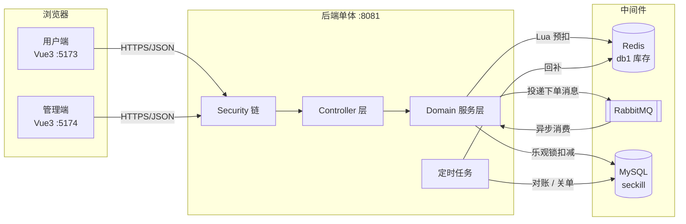
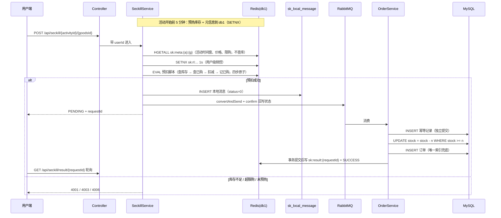

# 林间秒杀系统 · 技术方案

> 版本：v1.0（2026-10-30）
> 定位：个人项目 · 面向 Java 后端岗位的深度作品
> 本文档只描述方案与约束，业务代码尚未开始编写。

---

## 1. 项目定位

本项目是一个**单体分模块**架构的高并发秒杀交易系统，核心目标是完整呈现「库存不超卖、消息不丢失、下单可幂等、数据可对账」四条主线，并用可复核的压测数据支撑结论。

项目明确**不追求功能广度**。商品管理、活动配置等后台能力只做到支撑秒杀链路所需的最小集，精力集中在交易链路的一致性与性能上。

## 2. 关键决策记录

以下九项决策已确认，后续实现不得随意变更；如需变更，在本文档追加版本记录。

| 编号 | 决策项 | 结论 | 主要理由 |
|---|---|---|---|
| D1 | 架构形态 | 单体 + 领域分包，不引入注册中心与网关 | 单机部署成本低；避免「为微服务而微服务」的叙事漏洞 |
| D2 | 仓库组织 | 一项目一仓库，公开仓库 | Actions 分钟数不受限；公开代码本身构成作品集 |
| D3 | 前端组织 | 4 个独立工程，全部以 `后台管理系统/frontend` 为基座派生 | 复用 Axios 封装、JWT 刷新、路由守卫、Pinia 等基建 |
| D4 | 用户端形态 | 共享工程基建，但重做布局（顶部导航 + 列表 + 详情） | 保留后台布局会让 C 端项目在展示时不成立 |
| D5 | 一致性主方案 | Redis + Lua 原子预扣 → RabbitMQ 异步下单 → DB 乐观锁兜底 → 定时对账 | 唯一能同时回答超卖、少卖、丢单、幂等、对账五个追问的组合 |
| D6 | 消息中间件 | RabbitMQ（本机已装） | 削峰场景足够；避免引入 Kafka 的运维复杂度 |
| D7 | 限流组件 | Sentinel 单机版（不依赖 Nacos） | D1 已定不引入注册中心 |
| D8 | 数据层 | 单 MySQL 实例、`seckill` 单库；Redis 单实例按 db 划分 | 单机环境下多实例只增加运维成本 |
| D9 | 文档与压测 | springdoc-openapi + Knife4j；Apache JMeter 5.6.x | 注解直出可调试页面；JMeter 聚合报告可被简历引用 |

## 3. 技术栈与版本

| 层 | 选型 | 版本 | 说明 |
|---|---|---|---|
| JDK | Temurin OpenJDK | 21 | 本机已装 `D:\java\app\jdk-21.0.12.1+1` |
| 构建 | Maven | 3.10.0 | 本机已装 |
| 框架 | Spring Boot | 3.2.5 | 与现有两个项目保持一致以复用配置 |
| 持久层 | MyBatis-Plus | 3.5.6 | 与博客项目一致 |
| 安全 | Spring Security + JJWT | 0.12.5 | 从后台管理系统抽取 |
| 数据库 | MySQL | 8.x | 本机 `D:\mysql\app`，库名 `seckill` |
| 缓存 | Redis | 5.0.14 | 本机 `D:\Redis\app` |
| 消息 | RabbitMQ | 3.x | 本机 `D:\RabbitMQ\app`，服务需手动启动 |
| 流控 | Sentinel | 1.8.x | 单机模式，规则写在配置文件 |
| 文档 | springdoc-openapi + Knife4j | 2.3.x–2.5.x（Boot 3.2 对应区间）/ 4.5.0 | 坐标必须带 `jakarta` |
| 压测 | Apache JMeter | 5.6.x | 计划解压至 `D:\Apache JMeter\app` |
| 前端 | Vue 3 + Vite + Element Plus + Pinia + Axios | 3.4 / 5 | 从现有后台管理系统派生 |

> 版本约束说明：springdoc 官方兼容矩阵标注 Spring Boot 3.2.x 对应 springdoc 2.3.x–2.5.x，不得选用 2.6 以上。

## 4. 总体架构



关键约束：**所有写操作只有一个进程**（单体），因此不需要分布式锁；Redis 与 MySQL 之间的一致性由「预扣 + 异步落单 + 对账」三段保证，而不是靠分布式事务。

## 5. 后端模块划分

```
backend/
├── pom.xml                    父 POM，统一依赖版本
├── seckill-common/            统一响应、业务异常、错误码、雪花 ID、通用工具
├── seckill-security/          Spring Security 配置、JWT 签发与校验、RBAC 过滤器
├── seckill-domain/            实体、Mapper、Redis 操作、MQ 生产者/消费者、领域服务
└── seckill-web/               启动类、Controller、全局异常处理、定时任务、配置
```

| 模块 | 职责 | 依赖方向 |
|---|---|---|
| seckill-common | 无业务语义的基础设施 | 无 |
| seckill-security | 认证与授权 | common |
| seckill-domain | 全部业务逻辑与外部资源访问 | common、security |
| seckill-web | HTTP 入口与装配 | domain |

`seckill-web` 只做参数校验与编排，不允许出现 SQL 或 Redis 命令；这条规则用于在评审时判断分层是否被破坏。

## 6. 秒杀核心链路



**同步链路只有三次 Redis 往返，零次 MySQL 访问**——这是异步下单的意义所在。活动时间窗、价格、限购全部在预热时写进 `sk:meta`，扣减前不查库。

**Lua 脚本必须原子完成的动作**：判断库存、判断用户已购数量、扣减库存、累加用户已购。四项必须在同一个脚本里，否则并发下同一用户会重复通过限购校验。

## 7. 数据模型

### 7.1 表清单

| 表名 | 用途 | 关键约束 |
|---|---|---|
| `sk_activity` | 秒杀活动（专场） | 索引 `(status, start_time)`：预热任务按状态+时间扫描，两列顺序不能反，反了退化为全表扫；状态机 0 待开始 / 1 进行中 / 2 已结束 / 3 已取消 |
| `sk_goods` | 商品主数据 | **不含库存**。同一商品可参加多场活动、各场库存独立，库存挂在商品上会强迫多场共享一个库存池 |
| `sk_activity_goods` | 活动商品关联 + 库存主体 | `UNIQUE (activity_id, goods_id)` 防重复添加；`stock` 为剩余库存 |
| `sk_seckill_order` | 秒杀订单 | **`UNIQUE (user_id, activity_id, goods_id)`** 一人一商品只能买一次；`UNIQUE (request_id)` 让重复消费插入冲突，天然幂等；`idx_timeout (status, expire_time)` 供关单扫描 |
| `sk_idempotent_record` | 消费幂等表 | `UNIQUE (message_id)`，消费前插入，冲突即跳过 |
| `sk_local_message` | 本地消息表 | 记录待投递消息，`idx_status_retry (status, next_retry_time)` 供重投扫描，解决「Redis 已扣但 MQ 投递失败」 |

> 建模选择「一活动多商品」而非「一活动一商品」：代价是库存要按二维定位，Redis 键变成 `sk:stock:{activityId}:{goodsId}`；收益是专场可同时卖多个 SKU，且库存粒度天然独立。
>
> 订单表**没有逻辑删除列**：订单是资金凭证，只能改状态，不允许删除。

### 7.2 库存扣减 SQL

```sql
UPDATE sk_activity_goods
SET stock = stock - #{quantity}, version = version + 1
WHERE id = #{id} AND stock >= #{quantity};
```

**为什么不用 `updateById` + `@Version`**：那条路径要先 SELECT 整行再更新，读与写之间的窗口正是超卖的来源；而且单行热点下读到的版本号必然相同，只有一个能成功，其余的只能重试。

**为什么也不带 `version = #{version}` 条件（这里踩过坑）**：最初的实现是「乐观锁 + 重试 3 次」，压测里 20 个消费者同时扣同一行，1 个成功、19 个版本冲突，重试 3 次仍然抢不到，只能把消息重新入队——日志里出现「库存扣减版本冲突，重试耗尽」。虽然数据最终一致，但这等于给自己造了一把自旋锁。

正确做法是让 `WHERE stock >= n` 承担全部并发控制：InnoDB 行锁保证「判断+扣减」不可分割，20 个并发会排队执行、逐个成功，**不存在 CAS 失败，因此也不需要重试**。`version` 列仍自增，仅作审计信息。

> 判断标准：乐观锁适合「读多写少、冲突后可退避」的场景；秒杀是「单行极高并发写」，此时条件更新比版本号更强也更快。

## 8. Redis 键设计

| 键 | 类型 | 所在 db | 说明 |
|---|---|---|---|
| `sk:stock:{activityId}:{goodsId}` | String | 1 | 剩余库存，Lua 内扣减 |
| `sk:bought:{activityId}:{goodsId}` | Hash | 1 | field=userId，value=已购数量。用 Hash 不用 Set 是为了支持 `limitPerUser > 1` |
| `sk:meta:{activityId}:{goodsId}` | Hash | 1 | 活动时间窗、价格、限购、商品名快照。**秒杀链路因此完全不查库** |
| `sk:preheat:goods:{activityId}` | Set | 1 | 该活动已预热的商品 ID，用于活动结束时**精确清理**，避免用 `KEYS` 全库匹配 |
| `sk:result:{requestId}` | Hash | 1 | 下单结果（PENDING/SUCCESS/FAILED + orderNo），TTL 30 分钟供前端轮询 |
| `sk:rl:{a}:{g}:{userId}` | String | 1 | 用户级频控，TTL 1 秒，挡住脚本连点 |
| `sk:refresh:{userId}` | String | 0 | Refresh Token，与 security 模块共用 db0 |

**不使用 `KEYS` 命令**；批量清理统一走 `SCAN`。所有键必须带 `sk:` 前缀。

**Lua 返回值约定（实现时踩过的坑）**：`-1` 未预热、`-2` 库存不足、`-3` 超出限购、`>=0` 扣减后的剩余库存。**不能拿 0 表示「库存不足」**——扣完最后一件时 `DECRBY` 的返回值也是 0，两个语义相撞会让最后一件商品被误判为售罄。

**双库配置的隐性陷阱**：Spring Boot 的 `LettuceConnectionConfiguration` 带 `@ConditionalOnMissingBean(RedisConnectionFactory.class)`，`RedisAutoConfiguration` 的 `StringRedisTemplate` 也带 `@ConditionalOnMissingBean`。一旦把库存连接工厂或模板注册成 Bean，Boot 会**整体放弃**自动配置，容器里只剩 db1，于是登录 Token 被静默写进库存库。本项目实测踩中过（refreshToken 出现在 db1）。正确做法是 `StockRedisTemplateHolder` 只注册自己，工厂与模板都由它内部持有并 `@PreDestroy` 释放。

## 9. 消息队列设计

| 项 | 设计 |
|---|---|
| Exchange | `seckill.order.exchange`（direct，durable） |
| Queue | `seckill.order.queue`（绑定死信交换机） |
| Routing Key | `seckill.order.create` |
| 死信 | `seckill.order.dlx.exchange` → `seckill.order.dlq` |
| 消费幂等 | 插入 `sk_idempotent_record(message_id)`，冲突即 ack 跳过；订单表 `uk_request` 是第二道保险 |
| 消费失败 | 首次失败 requeue 一次（可能是数据库瞬时不可用），第二次 nack 进死信，不无限重试 |
| 投递可靠性 | `publisher-confirm-type: correlated`；消息先写 `sk_local_message` 再发，confirm 异步回写状态，失败的由定时任务退避重投 |
| 业务失败 | DB 库存不足 / 重复购买 → **保留幂等记录**并回补 Redis，不重投（重投会重复补偿） |

**声明式拓扑的坑**：队列已存在但参数不同时，`QueueBuilder` 声明会抛 `PRECONDITION_FAILED - inequivalent arg`，监听器直接起不来。本项目实测踩中过（历史遗留的同名队列没有死信参数），处理方式是 `rabbitmqctl delete_queue` 后重启，由应用重新声明。

**幂等记录与业务事务的边界**：幂等记录必须**独立提交**，不能和「扣库存 + 插订单」放在同一个事务里。放一起的话，业务失败回滚会把「已处理」标记一起撤掉，消息重投时会再处理一遍，补偿逻辑跟着重复执行，Redis 库存被反复加回去。

## 10. 接口约定

统一响应体：

```json
{ "code": 200, "message": "success", "data": {}, "traceId": "a1b2c3d4e5f6a7b8" }
```

> 成功码沿用 200（与 `后台管理系统`、`博客系统` 一致），不使用 0。实现时 `traceId` 由 `TraceIdFilter` 写入 MDC，同时回写响应头 `X-Trace-Id`。

| 错误码 | 含义 |
|---|---|
| 200 | 成功 |
| 400 | 参数校验失败 |
| 403 | 无权限访问 |
| 4001 | 库存不足 |
| 4002 | 活动未开始或已结束 |
| 4003 | 重复抢购 |
| 4004 | 请求过于频繁（限流） |
| 4006 | 库存尚未预热 |
| 4010 | 未登录或令牌失效 |
| 4107 | 订单状态不允许该操作 |
| 5000 | 服务内部错误 |

所有接口必须带 `traceId`，日志中以 `traceId` 串联，压测出问题时靠它定位。

**秒杀接口的返回约定**：`POST /api/seckill/{activityId}/{goodsId}` 成功时不返回订单，而返回 `{status: "PENDING", requestId}`。前端用 `GET /api/seckill/result/{requestId}` 轮询，拿到 `SUCCESS + orderNo` 才跳订单页。这不是为了「看起来异步」，而是因为落单要走 DB 事务，把它压进同步链路会让接口 P99 直接取决于数据库。

## 11. 一致性设计要点

| 风险 | 手段 |
|---|---|
| 超卖 | Redis Lua 原子预扣（库存+限购同一脚本）+ DB `WHERE stock >= n` 条件更新，双重拦截 |
| 少卖 | 消费失败重回队列一次后进死信；对账任务发现 `Redis < DB` 时告警（**不自动补**，因为在途消息会造成误判） |
| 丢单 | 本地消息表 + 定时退避重投 + publisher-confirm |
| 重复下单 | `sk_seckill_order` 双唯一索引（`request_id`、`user_id+activity_id+goods_id`）+ `sk_idempotent_record` |
| 重复补偿 | 业务性失败**保留**幂等记录，避免消息重投时把 Redis 库存重复加回去 |
| 库存悬空 | 预扣成功但消息落库失败 → 同步回补 Redis；活动结束后清理键时判定键存在性，不凭空造键 |
| 数据漂移 | 对账任务按方向区别处理：`Redis > DB` 立即修正（防超卖），`Redis < DB` 只告警（可能是在途） |
| 恶意刷单 | 用户级 Redis SETNX 频控（1 秒）+ Lua 内限购校验 |

**对账的方向不对称是有意的**：自动向两个方向修正看似「更一致」，实际会把在途消息的扣减覆盖掉，反而制造超卖。对账的原则是「宁可少卖，不能多卖」。

## 12. 前端工程

| 工程 | 基座 | 页面范围 |
|---|---|---|
| `frontend-user` | 派生自后台管理系统 frontend，替换布局 | 登录/注册、活动列表、商品详情、秒杀下单、订单结果轮询、我的订单 |
| `frontend-admin` | 直接沿用基座布局 | 商品管理、活动管理、订单查询、库存调整、监控看板 |

用户端保留基座的 `request` 封装、token 刷新、路由守卫，但**不复用**侧边栏布局与表格组件风格。

## 13. 工程化

- `docker-compose.yml` 编排：`mysql` / `redis` / `rabbitmq` / `seckill-web` / `nginx`（托管两个前端构建产物）。
- 后端镜像基于 `eclipse-temurin:21-jre`，多阶段构建（Maven 阶段 + 运行阶段）。
- GitHub Actions：`push` 与 `pull_request` 触发 `mvn verify`、`npm ci && npm run build`、`docker build`。公开仓库不消耗 Actions 分钟额度。
- 本地中间件为解压版且未注册为 Windows 服务，需提供 `scripts/start-infra.ps1` 与 `stop-infra.ps1` 手动启停脚本。

## 14. 压测方案

| 项 | 内容 |
|---|---|
| 工具 | Apache JMeter 5.6.x |
| 场景一 | 活动开始瞬间 500 并发抢 100 件商品，持续 30 秒 |
| 场景二 | 500 并发持续 60 秒稳态压测 |
| 观测指标 | TPS、P99、错误率、Redis QPS、MySQL 慢查询数、MQ 堆积深度 |
| 判定口径 | 以 JMeter 聚合报告为准，禁止只报平均响应时间 |

**以下为目标值，未实测前不得写入简历**：零超卖、错误率 < 1%、P99 < 500ms、TPS 目标 1000 以上（单机，需实测校验）。

压测后必须补一节「优化前后对比」，至少包含一次真实优化（如合并库存判断的 Redis 往返、调整连接池、索引优化）及其量化收益。

## 15. 里程碑

| 周次 | 内容 | 产出物 |
|---|---|---|
| W1 | 中间件启停脚本、Maven 骨架、鉴权链路 | 可启动的空工程 + 登录接口 |
| W2 | 商品/活动/库存 CRUD、库存预热 | Knife4j 可调试接口 |
| W3 | Lua 预扣、MQ 投递与消费、幂等落单、关单回补、对账 | 完整秒杀链路 |
| W4 | 4 个前端工程（本项目 2 个） | 可完整走通下单流程 |
| W5 | Docker 化、CI、JMeter 压测、文档 | 上线级交付包 + 压测报告 |

## 16. 验收清单

1. `mvn verify` 通过；核心 Service 有 JUnit 5 + Mockito 单测，控制器有 MockMvc 接口测试。
2. `docker compose up` 一条命令拉起 MySQL、Redis、RabbitMQ、后端、Nginx。
3. GitHub Actions 全绿。
4. 仓库含 `技术方案.md`、`本地运行说明.md`、`面试准备.md`、`docs/压测报告.md`。
5. 压测报告含原始聚合报告截图与可复现的 JMX 文件。

## 17. 风险与已知限制

| 风险 | 说明 | 应对 |
|---|---|---|
| 前端工作量 | 4 个前端工程摊薄后端深度 | 用户端页面数控制在 6 个以内，管理端只做列表与表单 |
| 单机压测天花板 | 单进程无法证明水平扩展能力 | 文档中明确「设计上可水平扩展」的依据（无状态、库存外置），不谎称已扩展 |
| 时间盒偏紧 | 5 周含 Docker 与 CI | 若 W3 未如期完成，砍管理端页面，保交易链路 |
| 中间件未注册服务 | 每次重启机器需手动拉起 | 提供脚本，README 首屏写清启动顺序 |

## 18. 变更记录

| 版本 | 日期 | 变更 |
|---|---|---|
| v1.0 | 2026-10-30 | 初版，沉淀 D1–D9 决策 |
| v1.1 | 2026-10-30 | W2 完成：一活动多商品建模落地，Redis 双库隔离，预热定时任务 |
| v1.2 | 2026-10-30 | W3 完成：异步下单链路（本地消息表 + confirm + 死信）、幂等落单、超时关单回补、库存对账。**修正乐观锁方案**——实测 20 并发下版本号重试全部耗尽，改为条件更新 |
